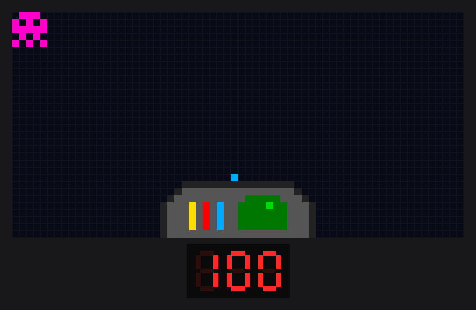
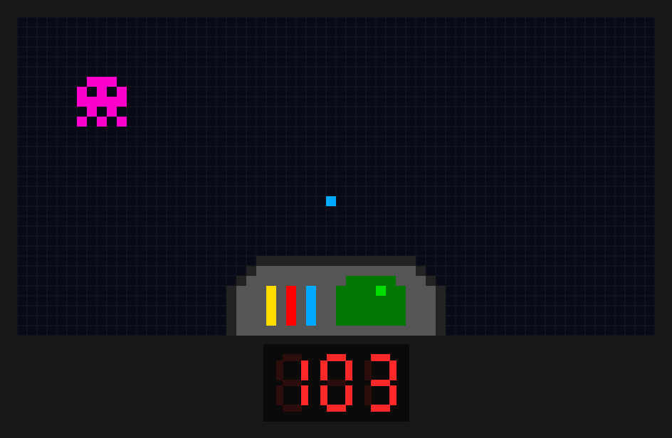

# Spaceship & Asteroids in Assembly

An early version of a spaceship game written in **PEPE-16 assembly**, the
16-bit processor used in IST's computer-architecture course, and run in the
course's circuit simulator. It drives a 32 × 64 pixel screen, three 7-segment
displays and a 4 × 4 keypad, all through memory-mapped peripherals.

Group 64 project at Instituto Superior Técnico (2022/23), by
Manuel Fernandes (ist1106410) and Tomás Cândido (ist1106470).

## What it does

- Draws the **spaceship's instrument panel** at the bottom of the screen: a
  grey hull with yellow, red and blue indicator lights and a green radar.
- Draws an **asteroid** from a 5 × 5 sprite table in the top-left corner.
- Draws a **probe** (one blue pixel) above the ship.
- Shows an **energy counter** on the 7-segment displays, starting at `100`.
- Reads the keypad, and reacts once per key press: holding a key does not
  repeat the action.

| Key | Action |
|---|---|
| `0` | Moves the asteroid one pixel down and right, and plays a sound |
| `1`, `2`, `3` | Moves the probe one pixel up |
| `C` | Increases the counter by 1 |
| `D`, `E`, `F` | Decreases the counter by 1 |

| Start | After a few key presses |
|---|---|
|  |  |

These images were rendered by emulating the program instruction by
instruction and drawing the screen and displays it writes to. In the real
simulator a background video also plays behind the pixels.

## How it works

All input and output goes through memory addresses:

| Address | Peripheral | Used for |
|---|---|---|
| `6000H` + offset | MediaCenter | Selecting a pixel's line and column and writing its colour, clearing the screen, choosing the background, playing sounds |
| `0A000H` | 7-segment displays | Showing the counter |
| `0C000H` / `0E000H` | Keypad lines / columns | Scanning the keypad |

- **Keypad scanning:** the `teclado` routine activates one keypad line at a
  time and reads which column is pressed. It returns the line number and the
  column in one byte.
- **One action per press:** the last key read is stored in memory
  (`DEF_TECLA`). The main loop only acts when the key read differs from it, so
  a key held down is handled once.
- **Sprites from tables:** the asteroid is described by a table of its width,
  height and the colour of each pixel (`DEF_BONECO`). The same routine draws
  it, and erases it by drawing transparent pixels before each move.
- **Panel drawing:** the hull and radar are drawn line by line, widening each
  line to form the sloped edges. Colours are 16-bit ARGB values.
- Every routine saves the registers it changes on the stack and restores them
  before returning.

## Running it

1. Open IST's circuit simulator with a PEPE-16 processor, a MediaCenter
   (32 × 64 screen), three 7-segment displays and a 4 × 4 keypad, wired to the
   addresses above.
2. Load `spaceship_asteroids.asm` into the processor, assemble it and start it.
3. Use the keys in the table above.

## Limitations

This is an intermediate version of the project, so some things are not
finished:
- The asteroid and the probe only move when keys are pressed; there are no
  timers or interrupts yet.
- Their positions are not limited, so they can move off the screen.
- The counter is written to the displays as a hexadecimal number, so after
  `109` it shows `10A`.
